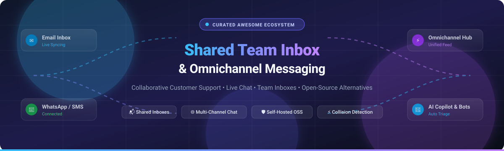

# 📬 Awesome Shared Team Inbox & Omnichannel Messaging 💬

  
  
  
  
  
  

  <b>A curated catalog of leading SaaS tools and production-ready open-source platforms for Shared Team Inboxes, Omnichannel Messaging, and Multi-channel Customer Support.</b>

---

## 📑 Table of Contents

- [📊 Sector Overview & Market Dynamics](#-sector-overview--market-dynamics)
- [☁️ SaaS / Hosted Platforms](#️-saas--hosted-platforms)
- [💻 Open-Source GitHub Projects](#-open-source-github-projects)
- [🧩 Feature Comparison Matrix](#-feature-comparison-matrix)
- [🎯 How to Choose](#-how-to-choose)
- [🤝 Contributing](#-contributing)
- [⭐ Star History](#-star-history)
- [💖 Support](#-support)
- [📜 License & Disclaimer](#-license--disclaimer)

---

## 📊 Sector Overview & Market Dynamics

The global customer communication and omnichannel customer service market is estimated at **$11.5 billion in 2024**, with projections reaching over **$24.8 billion by 2030** at a compound annual growth rate (CAGR) of **~13.6%** 📈. 

The sector displays a **moderately fragmented** market structure: while enterprise titans like HubSpot, Salesforce, and Zendesk command substantial market share through expansive CRM/helpdesk suites, deep specialization has empowered agile innovators—such as Front (collaborative email), Intercom (AI-native chat & product tours), and Crisp (SMB omnichannel)—to capture dedicated, high-growth customer segments alongside a vibrant, production-grade self-hosted open-source ecosystem 🚀.

---

## ☁️ SaaS / Hosted Platforms

*Sorted in descending order by company scale (market capitalization, recent valuation, or estimated annual revenue).* 🏢

| Platform | Company Size (Valuation / Revenue) | Starting Price (Specific Tier) | Free Tier & Trial Limits | Key Features & Focus |
| :--- | :--- | :--- | :--- | :--- |
| **[HubSpot Conversations Inbox](https://www.hubspot.com/)** 🧡 | ~$30.5B Market Cap (NYSE: HUBS) | **$15/user/month** (*Service Hub Starter*, billed annually) | **Free Forever Plan**: Up to 5 users, 1 shared email inbox & live chat widget, basic ticketing, 1 automated email/form | Native CRM integration, unified social & live chat, deal tracking, contact timeline history |
| **[Zendesk](https://www.zendesk.com/)** 🟢 | ~$10.2B Valuation (Acquired by Hellman & Friedman / Permira) | **$19/agent/month** (*Support Team*, billed annually) | **14-Day Free Trial**: Full access to Suite Team/Growth features, up to 5 test agents, no credit card required | Enterprise ticketing, complex SLA management, triggers & macros, 1,200+ app marketplace integrations |
| **[Intercom](https://www.intercom.com/)** 💬 | ~$3.9B Valuation (Est. Revenue ~$300M+ ARR) | **$39/seat/month** (*Essential Plan*, billed annually) | **14-Day Free Trial**: Full access to Essential features, Fin AI Agent preview, Messenger customization | AI-first customer service with Fin AI copilot, product tours, proactive outbound messaging |
| **[Front](https://front.com/)** 📬 | ~$1.7B Valuation (Series D) | **$19/seat/month** (*Starter Plan*, billed annually, min 2 seats) | **7-Day Free Trial**: Full access to Starter plan features, up to 10 team seats, omni-channel inbox access | Gold standard for collaborative email, internal comments & mentions, message collision detection |
| **[Help Scout](https://www.helpscout.com/)** 💙 | ~$50M ARR (Bootstrapped / Private) | **$22/user/month** (*Standard Plan*, billed annually) | **15-Day Free Trial**: Standard plan features, 2 shared mailboxes, Docs knowledge base, Beacon live widget | Human-centered shared inbox, Docs knowledge base, light CRM, customer satisfaction ratings |
| **[Crisp](https://crisp.chat/)** ⚡ | ~$25M ARR (Self-funded / Profitable) | **$25/workspace/month** (*Pro Plan*, includes 4 seats) | **Free Forever Plan**: Basic tier for 2 seats, live website chat widget, 30-day message history, contact inbox | All-in-one live chat, team inbox, audio/video call integration, multi-lingual knowledge base |
| **[Hiver](https://hiverhq.com/)** 📧 | ~$15M ARR | **$19/user/month** (*Lite Plan*, billed annually) | **7-Day Free Trial**: Full access to Pro features, unlimited shared Gmail inboxes, collision detection | Gmail-native shared inbox, turn Google Workspace into a helpdesk, email assignments & SLA tracking |
| **[Groove](https://www.groovehq.com/)** 📨 | ~$12M ARR | **$16/user/month** (*Standard Plan*, billed annually) | **30-Day Free Trial**: Full access to all features, unlimited inboxes, custom reporting, live chat widget | Simple shared inbox for small teams, canned responses, satisfaction ratings, clean UX |
| **[Missive](https://missiveapp.com/)** ✉️ | ~$8M ARR (Bootstrapped / Profitable) | **$14/user/month** (*Starter Plan*, billed annually) | **Free Forever Plan**: Up to 3 users, 1 shared account, 15 days of searchable message history | Collaborative email & internal team chat, shared drafts, social inbox, multi-account consolidation |
| **[Gmelius](https://gmelius.com/)** 📥 | ~$6M ARR | **$15/user/month** (*Flex Plan*, billed annually) | **7-Day Free Trial**: Full access to shared inboxes, Kanban boards, and email sequencing templates | Gmail & Google Workspace integrated shared inbox, Kanban boards, email sequences & notes |

---

## 💻 Open-Source GitHub Projects

*Sorted in descending order by GitHub stargazers count.* ⭐

| Project | Stars | Primary Architecture | License | Description & Differentiator |
| :--- | :--- | :--- | :--- | :--- |
| **[Chatwoot](https://github.com/chatwoot/chatwoot)** 💬 |  | Ruby on Rails, Vue.js, PostgreSQL, Redis | MIT | Full-featured omnichannel customer engagement platform. Unifies website live chat, WhatsApp, Twitter/X, Facebook, SMS, and email. Includes Captain AI agent and multi-inbox routing. |
| **[Papercups](https://github.com/papercups-io/papercups)** ☕ |  | Elixir / Phoenix, TypeScript, React | MIT | Open-source customer messaging platform. Embeddable chat widget, Slack & Microsoft Teams two-way sync, email forwarding, and customizable shared inbox UI. |
| **[Zammad](https://github.com/zammad/zammad)** 🛡️ |  | Ruby on Rails, PostgreSQL, Elasticsearch | AGPL-3.0 | Web-based open-source ticketing and shared support system with real-time collision detection, telephone/SIP integration, multi-channel support, and REST APIs. |
| **[FreeScout](https://github.com/freescout-help-desk/freescout)** 🕊️ |  | PHP (Laravel), MySQL | AGPL-3.0 | Lightweight, self-hosted Zendesk & Help Scout alternative. Zero limitations on users, tickets, or mailboxes. Collision detection, internal notes, and lightweight server requirements. |
| **[osTicket](https://github.com/osTicket/osTicket)** 🎫 |  | PHP, MySQL | GPL-2.0 | Proven, widely deployed open-source ticket routing engine and shared mailbox system with customizable ticket forms, SLA rules, and rich email routing. |
| **[Chaskiq](https://github.com/chaskiq/chaskiq)** 📯 |  | Ruby on Rails, React | Apache-2.0 | Conversational marketing and support platform. Intercom alternative with conversational bots, custom message tours, video calls, and omnichannel inboxes. |
| **[Libredesk](https://github.com/abhinavxd/libredesk)** ⚡ |  | Go, React, SQLite / PostgreSQL | AGPL-3.0 | Modern single-binary open-source customer support desk. Multi-inbox email management, smart automations, AI-assisted draft responses, and ultra-fast deployment. |
| **[WACRM](https://github.com/ArnasDon/wacrm)** 📱 |  | TypeScript, Next.js, Node.js | MIT | Self-hostable CRM and shared team inbox specifically designed for WhatsApp. Sales pipelines, multi-agent WhatsApp broadcasting, and webhook automations. |
| **[Live Helper Chat](https://github.com/livehelperchat/livehelperchat)** 🗣️ |  | PHP, Node.js, MySQL | Apache-2.0 | Highly scalable live support system with Telegram, WhatsApp, and Facebook integrations, voice chat, co-browsing, and shared departmental inboxes. |
| **[Modmail](https://github.com/modmail-dev/Modmail)** 🤖 |  | Python, Discord API | MIT | Collaborative shared inbox bot for community support and moderation teams, allowing multiple staff members to converse seamlessly with users through direct messages. |
| **[Tiledesk](https://github.com/Tiledesk/tiledesk)** 🧩 |  | Node.js, MongoDB | MIT | AI chatbot and omnichannel human agent live support platform. Visual no-code conversational designer, WhatsApp Business integration, and seamless agent handoff. |

---

## 🧩 Feature Comparison Matrix

| Feature | Chatwoot | FreeScout | Front | Intercom | Zendesk |
| :--- | :---: | :---: | :---: | :---: | :---: |
| **Deployment Model** 🏗️ | Self-Hosted / Cloud | Self-Hosted | Cloud Only | Cloud Only | Cloud Only |
| **Open Source** 🔓 | ✅ (MIT) | ✅ (AGPL-3.0) | ❌ | ❌ | ❌ |
| **Email Shared Inbox** 📧 | ✅ | ✅ | ✅ | ✅ | ✅ |
| **Live Chat Widget** 💬 | ✅ | ⚠️ (via Module) | ✅ | ✅ | ✅ |
| **WhatsApp / Social Channels** 📱 | ✅ | ⚠️ (via Modules) | ✅ | ✅ | ✅ |
| **Collision Detection** ⚠️ | ✅ | ✅ | ✅ | ✅ | ✅ |
| **Internal Mentions & Chat** 👥 | ✅ | ✅ | ✅ | ✅ | ✅ |
| **Native AI Support Agents** 🤖 | ✅ (Captain) | ⚠️ (via Plugin) | ✅ | ✅ (Fin) | ✅ |

---

## 🎯 How to Choose

- **For full omnichannel breadth on open source** 🌐: Choose **[Chatwoot](https://github.com/chatwoot/chatwoot)** if your team handles website visitors, WhatsApp conversations, Instagram DMs, and incoming email tickets all under one roof.
- **For lean, self-hosted email management** 🚀: Choose **[FreeScout](https://github.com/freescout-help-desk/freescout)** or **[Libredesk](https://github.com/abhinavxd/libredesk)** if you want minimal infrastructure requirements and straightforward shared mailbox delegation.
- **For teams living inside Google Workspace** 📨: Choose **[Hiver](https://hiverhq.com/)** or **[Gmelius](https://gmelius.com/)** to keep agents inside Gmail without switching applications.
- **For AI-first customer experience** 🤖: Choose **[Intercom](https://www.intercom.com/)** for enterprise-grade autonomous customer service and proactive messaging.
- **For high-velocity email collaboration** ✨: Choose **[Front](https://front.com/)** for the highest-rated collaborative email user experience.

---

## 🤝 Contributing

Contributions, new tools, and updates are very welcome! 💡

1. 🍴 Fork this repository.
2. 📝 Add your tool to the corresponding table with verified pricing or star count.
3. 🔍 Keep descriptions factual, objective, and concise.
4. 🚀 Submit a Pull Request with a clear title and summary.

---

## ⭐ Star History

---

## 💖 Support

Thank you for exploring this curated ecosystem! If you found this list helpful, please consider:

- ⭐ **Starring** the repository on GitHub
- 🍴 **Forking** it to keep a personal copy or contribute improvements
- 📢 **Sharing** with your fellow team leads, developers, and support teams
- ☕ **Buying a coffee / sponsoring** the maintainer via the [GitHub Sponsor Dashboard](https://github.com/sponsors/ishandutta2007)

Your support keeps open-source and curated resources alive and up to date! 🙌

---

## 📜 License & Disclaimer

- Distributed under the [Creative Commons Zero v1.0 Universal](LICENSE) (Public Domain) ⚖️.
- *Disclaimer*: Product names, logos, and brands are property of their respective owners. Pricing tiers, limits, and market metrics reflect public estimates and official documentation as of late 2026 and are subject to change by vendors.
